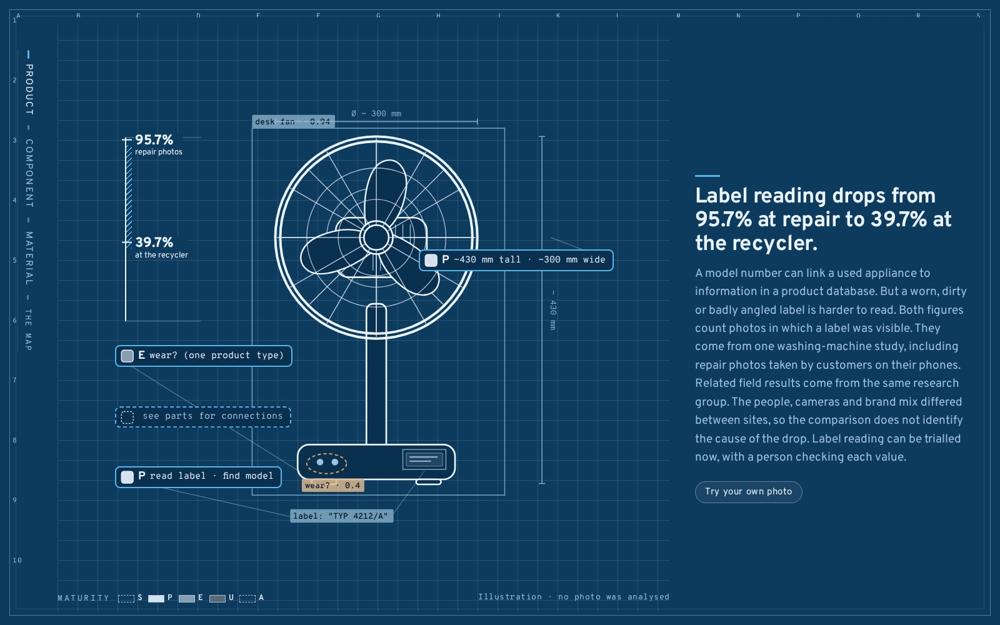

# What can a machine actually see? · CV × industrial ecology

[](https://github.com/simonvanlierde/cv-ie-taxonomy/actions/workflows/ci.yml)
[](https://codecov.io/gh/simonvanlierde/cv-ie-taxonomy)
[](https://simonvanlierde.github.io/cv-ie-taxonomy/)
[](LICENSE)
[](LICENSE-CONTENT)

An interactive map from the review article *Benchmarked, Rarely Field-Tested:
Computer Vision for End-of-Life Product Data in Industrial Ecology* (van Lierde
et al., [citation: forthcoming]). It shows what cameras and image software
(computer vision) can tell about a used product, and how far you can trust each
answer.



**[▶ Open the live demo](https://simonvanlierde.github.io/cv-ie-taxonomy/)**

A worn-out desk fan comes apart as you scroll, through Product → Component →
Material. Each label on it opens one cell of the paper's map, and the last
screen shows all twelve cells, with a **Plain table** button for the same data.
No task reaches Strong on field photos. Label reading, for example, falls from
95.7% on repair photos to 39.7% at the recycler.

## Data and assumptions

[`src/data/taxonomy.json`](src/data/taxonomy.json) mirrors **Table S2** of the
paper, and [`src/data/taxonomy.test.ts`](src/data/taxonomy.test.ts) fails if it
drifts from the paper's rules.

- The read-outs on the fan are simulated **mock values** that show what each
  technique outputs: I didn't run a model on the drawing. The verdict letters
  come from the paper.
- The desk fan stands in for any WEEE product (waste electrical and electronic
  equipment). The taxonomy isn't tied to one product: its evidence comes from
  washing machines, laptops, smartphones, and vehicles. The drawing is
  schematic, not to scale.
- Verdicts are a **June 2026 snapshot**. The taxonomy's structure is the part
  meant to last.

## Accessibility

Maturity shows as ink weight, letters and, in `forced-colors` mode and print,
textures, never colour alone. The three scale colours come from the
colourblind-safe Okabe–Ito palette. Every label and cell is a button with an
accessible name, and the detail view closes with `Esc`. `prefers-reduced-motion`
stops the idle spin and swaps the scroll animation for jumps between poses.

## Develop

Requires Node 26 or later.

```sh
pnpm install
pnpm dev         # http://localhost:5173
pnpm test        # data + interaction tests, jsdom (vitest)
pnpm build       # typecheck + production build
```

`pnpm test:browser` runs the tests that need real Chromium (focus return,
`inert`, the top layer, `ResizeObserver` layout); install it once with
`pnpm exec playwright install chromium`. `pnpm test:all` runs both, and so does
CI. CI also runs `pnpm check` (Biome) and `pnpm check:theme`, which fails if a
surface colour in CSS or HTML differs from `src/theme.ts`.

URL parameters: `?cell=component-structure` opens a detail (ids are
`<scale>-<information type>` in lower case), `?theme=dark|light` forces a theme,
and `?scene=2` pins a scene for screenshots (0 is the opening, 4 the map).

## License

The license is split so anyone can reuse the code, while the research stays
citable:

- **Code**: [MIT](LICENSE).
- **Taxonomy data** (`src/data/taxonomy.json`, mirroring Table S2), **figures, and
  content**: [CC BY 4.0](LICENSE-CONTENT).
