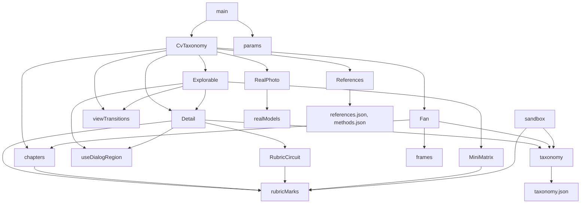

# How the site works

The site is one static React 19 page built with Vite. It has no server code and
no runtime backend. Everything the reader sees comes from the JSON files in
`src/data`.

## Data

| File                                 | What it holds                                                                                                                              |
| ------------------------------------ | ------------------------------------------------------------------------------------------------------------------------------------------ |
| `src/data/taxonomy.json`             | The source of truth: every cell's rubric marks, rating and evidence, as in the paper's Table S2.                                           |
| `src/data/references.json`           | The reference list. Prose cites a source by key; `References.tsx` turns the key into an author-year link, so a key never reaches the page. |
| `src/data/methods.json`              | The named models and datasets that open a reference card.                                                                                  |
| `src/data/deposit-rubric-marks.json` | A copy of the deposited rubric marks. Only tests and the What if? sandbox read it.                                                         |

`src/data/taxonomy.ts` loads `taxonomy.json` and exposes lookups (`cells`,
`cellById`, `cellAt`, maturity names). `src/data/types.ts` holds the types.
`src/data/deposit.test.ts` fails when `taxonomy.json` and the deposit copy
disagree on a cell, a mark or a rating. To change a rating, update the deposit
first, then bring `taxonomy.json` back in line.

## Modules

- **`main.tsx`** mounts `CvTaxonomy` and reads `?scene=` through `params.ts`.
- **`CvTaxonomy.tsx`** is the page: scroll scenes, the map, the plain table,
  the What if? controls and the layout switch. Styles live in `CvTaxonomy.css`.
- **`Fan.tsx`** draws the desk fan, its chips and the camera. `frames.ts` holds
  the hand-tuned camera frames; `chapters.ts` holds the scene copy and ties
  scroll position to a chapter.
- **`Detail.tsx`** holds the detail region for one task: verdict, failure limits,
  evidence and cited prose. `Explorable.tsx` wraps it in the map's own
  explorer, with `MiniMatrix.tsx` for moving between cells.
- **`rubricMarks.ts`** turns a cell's marks into runs, gaps and a verdict
  (`verdictOf`). `RubricCircuit.tsx` draws those runs.
- **`sandbox.ts`** re-derives verdicts from the reader's changed marks through
  `rubricMarks.ts`, and builds the CSV export.
- **`RealPhoto.tsx`** and **`realModels.ts`** run Tesseract or OWL-ViT on one
  photo in the browser. `realModels.ts` points both runtimes at files built
  into the site; only OWL-ViT's weights come from Hugging Face.
- **`viewTransitions.ts`** wraps the browser's view transition API as a
  progressive enhancement. **`useDialogRegion.ts`** gives a detail region
  focus handling, `Esc` and focus restore, modal on phones and non-modal on the
  sheet.
- **`theme.ts`** holds the colour variables and the one layout breakpoint.
  `pnpm check:theme` fails when the CSS breakpoint and colours drift from it.

## Tests

Vitest runs two projects, set in `vite.config.ts`.

- **`unit`** (`pnpm test`) runs in jsdom. It covers our own logic: the data,
  scoring, the sandbox, components and the config itself.
- **`browser`** (`pnpm test:browser`) runs `*.browser.test.tsx` in Chromium. A
  test goes here only when jsdom would make it a tautology: dialog focus restore,
  `inert`, the top layer, real layout for the phone seam, and the axe
  WCAG 2.2 AA checks.

CI also runs `pnpm check` (Biome) and `pnpm check:theme`.

## Build and deploy

`pnpm build` type-checks, then runs `vite build`. The build adds a
Content-Security-Policy `<meta>` tag to `index.html`, because the static
deployment has no Worker code to set headers. It also copies the Tesseract
data and ONNX runtime files so the page loads them from its own origin.

GitHub Actions builds `dist` and deploys it with Wrangler as a Cloudflare
Worker with static assets (`wrangler.toml`). `main` goes to production under
`/cv-ie-taxonomy/`; each trusted pull request gets a Preview URL at a hostname
root, and `outDir` and the base path change to match. [Deployment](deployment.md)
covers setup, cutover and rollback.
